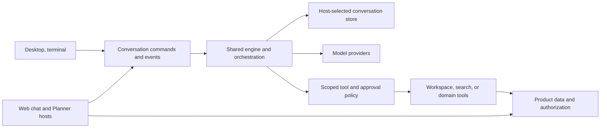

# An embeddable harness for coding and web applications

Research started 2026-11-11. The proposals here are open for discussion. The
[source survey](2026-11-11-embeddable-harness-sources.md) records revisions,
implementation traces, and evidence limits.

## What should be shared

The motivating case is the **ordinary web chat path** in a product like Open
WebUI. It should be able to use uploaded files, scoped retrieval, and application
tools inside the same runtime that powers a coding session. Open WebUI's
terminal-agent adapter is a useful transport reference. Its native chat has
its own model and tool loop, so that loop still needs its own improvements.
[Open WebUI source trace](2026-11-11-embeddable-harness-sources.md#open-webui).

Use the same conversation runtime to run a coding turn, answer a web chat with
files and search, or use Planner tools. A fix to tool cancellation, provider
retries, compaction, cache reuse, approval, or child agents should reach all three
without a client rebuilding the loop. Each product chooses its tools, context,
execution environment, policy, and UI. Tool execution can live on the user's
machine, a remote workspace, or inside a hosted product's domain services.

Harness already has much of this shape. The engine accepts a store, a plugin
host, a configuration resolver, and an evaluator. The service and JSON-RPC
session give clients a common conversation interface. The shipped composition
opens an exclusive local SQLite store, reads local settings and credentials,
initializes execution capabilities, and installs its product-specific APIs.
Generic conversation execution and a portable public host are different seams.
The current composition and store contract also carry workspace, worktree, and
host settings behavior. A second real consumer can expose which dependencies
need to move. [Engine](../../packages/core/src/engine.ts#L142-L152),
[store](../../packages/protocol/src/store.ts#L57-L142),
[server composition](../../packages/server/src/index.ts#L73-L115).

## Two ways to embed one runtime

| Mode                                         | Who owns the run and its data                                                                                                                                                                                                                          | When it fits                                                                                                                                                                 |
| -------------------------------------------- | ------------------------------------------------------------------------------------------------------------------------------------------------------------------------------------------------------------------------------------------------------ | ---------------------------------------------------------------------------------------------------------------------------------------------------------------------------- |
| **Connect to a runtime**                     | Harness owns transcript, run state, provider calls, and execution policy. The product owns authentication, navigation, conversation binding, and any derived views. It sends commands and renders state over RPC.                                      | A browser for an existing coding session, a Python or Go client, or a sidecar that can own its own store.                                                                    |
| **Compose a runtime in-process**             | The application constructs the same engine with local capabilities. A harness persistence module owns its tables and invariants within the application's database. The host can participate in selected commits using its actual database transaction. | Planner needs to create a chat, link an attachment, and durably accept its first turn in one operation. Hosted deployments may also need PostgreSQL for execution ownership. |
| **Run a loop over caller-supplied messages** | The application owns history, execution admission, interactions, and recovery. The library returns model and tool output.                                                                                                                              | Useful as a small library primitive. Every serious consumer would have to implement the stateful features again.                                                             |

The first two can share a core API and item model. A transport adapter translates
that API. In-process embedding can additionally wire trusted code and database
transactions, which are inherently local contracts. One deployed process per
application, per user, or per worker is an operational decision. A broker, a new
wire format, and a fleet of dedicated services have no role in the first proof.

The coding server, web chat, and Planner would assemble the same engine with
different capabilities. Each conversation has one history authority. A
conversation can be rendered by several clients at once.

An OpenAI-compatible model endpoint can be a convenience adapter for plain chat.
It has no standard way to represent Harness delivery intents, resumable approvals,
child conversations, or authoritative item identity. A feature-complete client
needs a conversation API. ACP is useful at the editor-to-agent boundary. MCP is
useful at the runtime-to-tool boundary. Neither needs to define Harness storage.
[ACP overview](https://agentclientprotocol.com/protocol/v1/overview),
[MCP tools](https://modelcontextprotocol.io/specification/2026-07-28/server/tools).

## Persistence is an ownership decision

**Make durable history, execution progress, and live output separate contracts.**
An immutable item history and a selected head describe what happened and what
goes in context. Small durable records describe what can happen next. Live
previews improve responsiveness and can be replaced on reconnect. Provider
continuation is opaque, versioned and bound to the provider/model that owns it.
Large outputs and attachments can be references with scoped reads. A recording
of every token and a serialized middleware stack add little to these contracts.

Define storage around the transitions that need atomicity. Keep the current
store until a concrete workflow demonstrates the need for each change.

| Transition                               | Atomic data and guarantee                                                                                                                                                                                                                                                                                |
| ---------------------------------------- | -------------------------------------------------------------------------------------------------------------------------------------------------------------------------------------------------------------------------------------------------------------------------------------------------------- |
| Accept input durably                     | Record a scoped command identity and its outcome alongside input and a queued turn or inbox entry. The same key and payload return the previous receipt. A changed payload with that key conflicts. For a hosted product, use the same transaction for its domain writes when the product requires them. |
| Start or advance work                    | Admit one owner for a conversation. Commit only under the current owner and expected phase. Local Harness can keep the exclusive process owner. A PostgreSQL worker deployment needs claim expiry and a fencing token on subsequent writes. Keep SQL transactions short around actual state changes.     |
| Publish model output and complete a turn | Persist finalized items and the usage/continuation needed for the next step. Commit the terminal state with the final transition before claiming success. Transient chunks and Redis notifications are delivery aids.                                                                                    |
| Accept an interaction response           | Consume one scoped request once. If an interaction survives process exit, persist the validated reply and what work it makes eligible in the same commit. A rejected or stale reply must leave the turn unchanged.                                                                                       |
| Record tool intent and outcome           | Give the logical invocation a stable execution identity, independent of a provider's call ID. Persist one canonical result. Keep the adapter's effect identity stable across retry or lost acknowledgment.                                                                                               |

Start with named operations for real invariants, such as submitting a command or
finishing an invocation. A common commit-batch format is an option if concrete
adapters repeatedly need to compose the same writes. Avoid exposing a generic
SQL executor, a mutable graph state blob, or transaction handles over RPC. A
remote client can ask a service to perform one atomic operation owned by that
service. Two independent stores require an explicit handoff, typically a
transactional outbox with an idempotent receiver, and have separate commit
points. Use that machinery only where an asynchronous handoff is required.

**Planner's mobile capture is the deciding example.** Today it can create a
conversation and link attachments and queue the first turn in one PostgreSQL
transaction. With an independent Harness daemon, it could commit a local
request and hand it off idempotently after commit. The UI would need to represent
the intermediate state and reconcile a lost acknowledgment. If Planner wants
the current atomic acceptance guarantee, a co-located persistence adapter is a
better fit. Shared PostgreSQL infrastructure alone gives no atomicity. Both
writes must use the same transaction. [Planner admission trace](2026-11-11-embeddable-harness-sources.md#planner).

The corresponding tool failure matters in both deployment modes. If
`create_item` succeeds and the runtime dies before writing the tool
result, a replacement worker must never blindly create a second item. A domain
operation under the same transaction can commit the mutation, invocation receipt,
and canonical result together. A remote tool can offer the same logical effect
through its own durable idempotency receipt. An arbitrary shell command or API
without that contract may leave an unknown outcome. Show that state and let the
next action inspect or reconcile it. A lease stops a stale worker from committing
harness state. Preventing a stale worker's external side effect requires a
domain-side fence, an idempotency contract, or an execution environment with an
appropriate ownership guarantee.

Admission and tool effects are independent choices. Planner can share the input
transaction and still prefer a receipt in its domain service for tool effects.
That lets the same tool run through an in-process call or through a remote
adapter. Receipt recovery requires reusing the original invocation and its
captured arguments. Re-running the model and accepting a newly emitted call
would create a new intent.

### Restart behavior can start small

- Persist an accepted hosted submission until a worker starts it. A local
  runtime may retain its current recovery policy, with that guarantee explicit
  to its clients.
- After starting a turn, preserve committed history, close dangling calls with
  an honest interrupted/unknown result, and stop. Resume specific boundaries
  when needed, such as a durably queued input, a persisted approval, or a tool
  with verified safe re-entry. Recovery should look at recorded phase and
  outcome. Assume a new model request may yield different output and incur new
  cost.
- If a provider stream breaks after output, retain finalized items and their
  accounting. Retrying an invocation before it yields usable output is a
  separate policy from retrying an accepted user command or replaying a tool.
- On reconnect, fetch committed state and an active snapshot. Use a revision or
  cursor to close the snapshot/subscribe gap and deduplicate committed updates.
  Replace old previews, or refill them from a bounded buffer if available.
  A slow subscriber can reconnect and rehydrate. The worker's progress stays
  independent of that connection.

This keeps a resumed conversation, a running turn reattached from another
client, and a crashed turn restarted at a known boundary distinct. Pi Durable,
DeepSeek Harness, and LangGraph make different choices about how far to go.
[Persistence comparisons](2026-11-11-embeddable-harness-sources.md).

## Extensibility and language choice

Keep the core and trusted in-process plugins in the same language. Existing
Harness middleware is already useful for model calls, tool calls, and requests.
Add narrow, typed contribution points when two real deployments need them.
Examples include a scoped context source, model provider, tool catalog,
compaction policy, and execution environment. Each has an owner and an explicit
lifetime. Policy and cancellation have a mandatory execution boundary.
Trusted middleware may participate in the loop. An observer, UI, or remote tool
gets only its own contract and cannot mutate the runtime's control state.
For example, a tool wrapper can shape arguments and collect output, but the
final dispatch always checks cancellation and authority against the effective
arguments. A typed, versioned tool result can support a Planner item card, an
edit diff, or a generic text display over the same event.

Applications and most extensions can use different languages through two
interfaces:

- **Conversation API.** Use the existing versioned JSON-RPC contract as the
  starting point for conversation creation, delivery, history, events,
  cancellation, and typed interactions. Negotiate host-specific capabilities.
  Keep the first non-TypeScript integration on that wire. Keep web
  authentication in the application's gateway and authorize every referenced
  conversation, child, attachment, and result.
- **Capability API.** Expose domain tools through MCP or an existing scoped
  service API with validated schemas, cancellation, time bounds, structured
  results, and per-invocation identities where effects require them. Pass
  narrowly scoped authority derived from the authenticated caller. Search
  results, file text, and model arguments carry data only. They cannot grant
  access or switch tenants.

A Rust or Go core is feasible with this split. The API and the SQL semantics
would remain the same. Keep TypeScript while testing the second host. Use a
foreign-language caller or tool for the first portability check. A rewrite
needs a demonstrated payoff, such as distribution or resource constraints.

### What an in-process FFI would have to carry

A C ABI can take a function pointer and a context pointer for a synchronous
callback. A host-language binding can retain closures in its own registry and
give the core descriptors with opaque handler IDs. For asynchronous hooks,
the core emits a request with a handler ID, invocation ID, and typed input.
The binding dispatches on the host's event loop and sends back a result or
error using the invocation ID. A cancellation event asks the host to stop
work. The core settles the invocation once and owns late-result handling.
For Node, native workers can enqueue calls onto the JavaScript thread using
Node-API. The binding still owns the registered handlers, Promise settlement,
and teardown. [Node-API thread-safe functions](https://nodejs.org/api/n-api.html#asynchronous-thread-safe-function-calls).

One dispatcher can carry several hook types. It does not give them the same
semantics. An observer can be a one-way event. A context or tool hook needs a
reply. A streaming model provider needs a stream and a terminal outcome.
An around-middleware hook that can call `next` needs a continuation back into
the core, with rules for re-entry and cancellation. A host-owned database
transaction still needs to execute the related changes on the same connection
under one owner.

For a fixed language pair, a dedicated binding can hide the bridge and expose
ordinary async functions to application code. For general-purpose embedding,
keep deep middleware native to the runtime and expose a few typed capability
requests across the language boundary. Reuse the same request and event model
for a binding or a subprocess when both modes have real consumers. The added
cost of FFI is runtime integration and lifetime management.

## Subagents and execution

Build delegation on the same runtime. A child is an explicitly owned
conversation with its own instructions, selected model, context, capability
grants, budgets, usage, and status. The parent records the relationship and
gets a bounded result or an artifact reference. The UI can inspect an authorized
child transcript. The parent's model does not need all of it. Keep child
admission, limits, join, cancellation, and outcome delivery as shared
orchestration. Child creation and linkage must agree durably before acknowledging
spawn if restart or duplicate delivery can race it.

Start with the current Harness child semantics. Specify what parent interruption,
client detach, explicit backgrounding, and worker death do independently. If
detached work is allowed, give it an explicit durable owner or retain the
existing process-bound guarantee. Child grants are constrained by host
authorization, parent delegation policy, and the selected profile. A child can
use a different model or sandbox within those grants. Privileged delegation
requires an explicit host-issued capability. Full transcript sharing and
remote execution are separate choices from spawning. [Harness orchestration](../subsystems/orchestration/README.md).

A coding profile can add a workspace and shell sandbox. Planner can add scoped
folder context, document references, and tools backed by its existing services.
General web chat can add search, files, and an optional sandbox or attached
machine. Preserve native provider features where supported and project them into
typed output and usage. UI-specific cards can render structured tool output
without requiring the engine to learn every product's domain schema.

## Which runtime to start from

- **Harness** already owns the coding behaviors this design aims to share.
  Adding one alternate composition tests whether those behaviors travel with
  the engine. The main changes to investigate are durable hosted admission
  and extracting host-specific dependencies from that composition.
- **Pi Durable** is the strongest candidate for a separate evaluation if
  durable task phases and host-defined commit batches become the dominant
  requirements. It is a separate runtime from classic Pi. Compare its real
  coverage of steering, approvals, provider continuation, sandbox policy, and
  usage with the Harness behavior we depend on before considering adoption.
- **Codex, OpenCode, or DeepSeek Harness as a subprocess** can be a good fit
  for a web UI that wants to operate existing coding sessions. Their protocol
  capabilities determine what the UI can show and control. Integrating
  Planner's own transactional submission and domain capabilities would still
  require a host-specific adapter. [Reference implementations](2026-11-11-embeddable-harness-sources.md).

## Two useful experiments

1. **Ordinary web chat runs on the Harness engine.** Give the chat composition
   no coding workspace. Attach a document, ask a question that requires a
   scoped search tool, and verify the answer uses both the document and the
   search result. Continue the same conversation after disconnecting during a
   streamed reply. Exercise cancellation and one interaction through the shared
   runtime. Check that a second user cannot read the conversation or its
   attachment. This tests the web product's actual chat path, including which
   capabilities can plug in and which coding assumptions must move out of the
   composition. The browser consumes the same conversation commands and events
   as the coding clients. It owns rendering and user interaction.
2. **Planner composes the same runtime.** Pick one real attachment admission and
   one mutating Planner tool. Compare remote handoff with an in-process
   transaction for those two operations. Kill the process after admission but
   before start, and after the domain effect but before acknowledgment. Send
   duplicate submissions, exercise lost ownership, and reconnect the client.
   A single mutation and a coherent canonical result or an explicit unknown
   outcome are the acceptance checks. Keep existing Planner history and UI
   migration out of the experiment.

Open decisions include whether Planner requires one-transaction admission,
which interactions must survive process death, and whether hosted worker
failover must resume active turns or can end them honestly. The first experiment
tests whether native web chat can share the engine and its lifecycle. The
Planner experiment can settle storage ownership before designing a general
adapter or changing languages.
